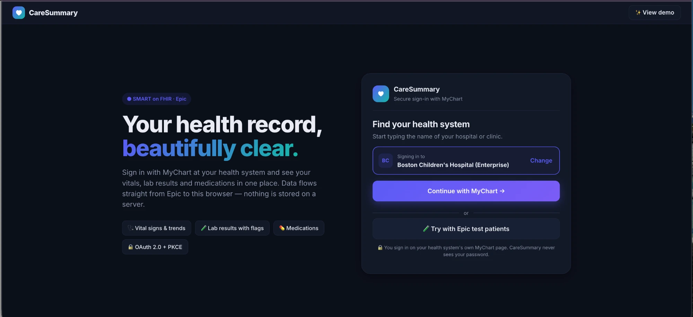
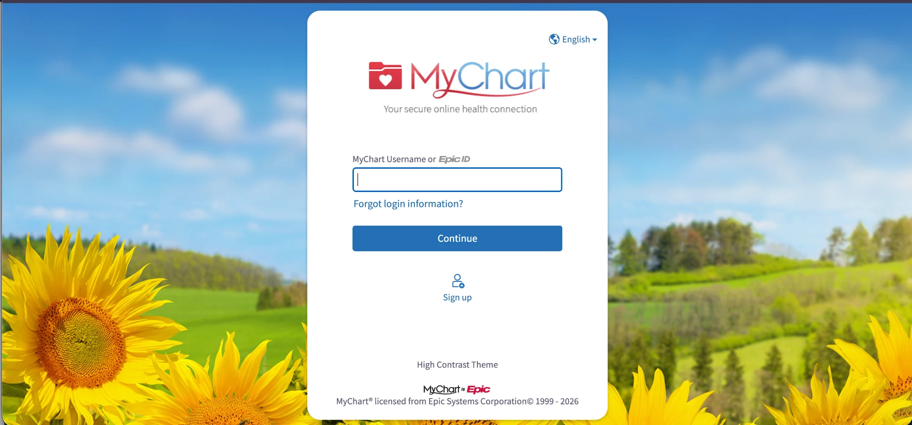
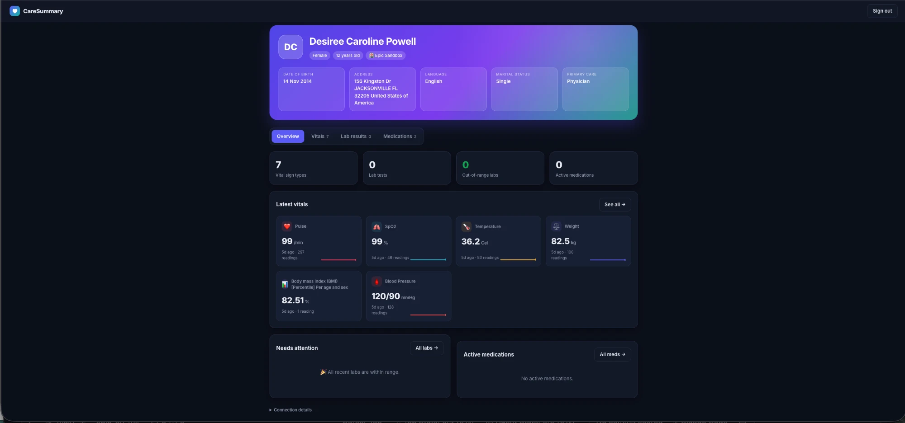

# CareSummary

CareSummary is a patient-facing **SMART on FHIR** app built on **Epic**. A patient picks their health system, signs in with MyChart, and gets a clear, modern view of their health record: profile, vital signs, lab results and medications, all in one dashboard.

## Screenshots

**1. Pick a health system**



**2. Sign in with MyChart**



**3. See the health record** (Epic sandbox test patient)



## What was built

**Epic app registration.** I registered the app on fhir.epic.com as a patient-facing app with non-production (sandbox) and production client IDs, and enabled only the APIs the dashboard needs:

- `Patient.Read (Demographics)`
- `Observation.Read (Vital Signs)`
- `Observation.Search (Vital Signs)`
- `Observation.Search (Labs)`
- `MedicationRequest.Search (Signed Medication Order)`

**Secure sign-in (SMART on FHIR + OAuth 2.0 PKCE).** The app is a public client, so it has no secret. For each health system it discovers the OAuth endpoints from `.well-known/smart-configuration`, falling back to the FHIR `/metadata`. It then sends the patient to their own MyChart login with a PKCE challenge and exchanges the returned code for an access token. The token stays in `sessionStorage` and is cleared on sign-out. Both standalone launch and EHR launch (from inside Epic) are supported.

**Health system search.** The sign-in page searches Epic's published directory of 477 R4 endpoints as you type, instead of showing a long list. It includes keyboard navigation, highlighted matches and a one-click option for Epic's sandbox test patients.

**Patient dashboard.** All data comes straight from Epic's FHIR R4 API:

- **Overview:** summary stats, the latest vitals, out-of-range labs that need attention, and active medications
- **Profile:** name, age, sex, date of birth, MRN, address, phone, language, marital status and primary care provider
- **Vitals:** latest reading per type (blood pressure, pulse, SpO₂, temperature, weight, BMI…) with sparkline trends and reading counts
- **Lab results:** searchable table with High/Low flags and reference ranges, plus a detail view showing history and the raw FHIR resource
- **Medications:** active and past prescriptions with dosage instructions, prescriber, reason and refills

**Design.** A dark, card-based UI with light-mode support, tabbed navigation and responsive layouts. Built with plain HTML, CSS and JavaScript, with no frameworks.

**Lightweight server.** A dependency-free Node server serves the app and reads client IDs from a git-ignored `.env` file, so no credentials live in the source code. A script refreshes the hospital directory from open.epic.com.

**Privacy.** Patient data goes directly from Epic to the browser. Nothing is stored on a server.

## Configuration

Settings live in `.env` (see `.env.example`):

| Variable | Description |
| --- | --- |
| `EPIC_NON_PROD_CLIENT_ID` | Non-production client ID (sandbox) |
| `EPIC_PROD_CLIENT_ID` | Production client ID (real health systems) |
| `REDIRECT_URI` | Must exactly match the redirect URI on the Epic app |
| `PORT` | Port to serve on (default `8045`) |
| `DEFAULT_ORGANIZATION` | Optional health system to preselect |
| `SCOPE` | Optional override for OAuth scopes |

## Project structure

```
├── server.js                  # Node server; serves app/ and /config.js from .env
├── scripts/update-endpoints.js
└── app/
    ├── index.html
    ├── app.js                 # SMART auth, FHIR calls, dashboard UI
    ├── style.css
    ├── demo-data.js           # Sample data for ?demo
    └── endpoints.json         # Epic R4 health systems
```

## Troubleshooting

| Problem | Fix |
| --- | --- |
| **"The request is invalid"** | `REDIRECT_URI` doesn't exactly match the Epic app |
| **"OAuth2 Error"** at a hospital | The production client ID isn't active there yet |
| **Port 8045 in use** | Stop the other server or change `PORT` and `REDIRECT_URI` |
| Empty data sections | Check the matching Incoming API is enabled on the Epic app |

## Credits

Built with the help of [Claude](https://claude.ai) by Anthropic.
